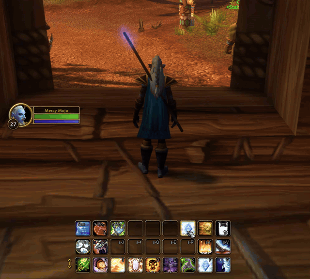
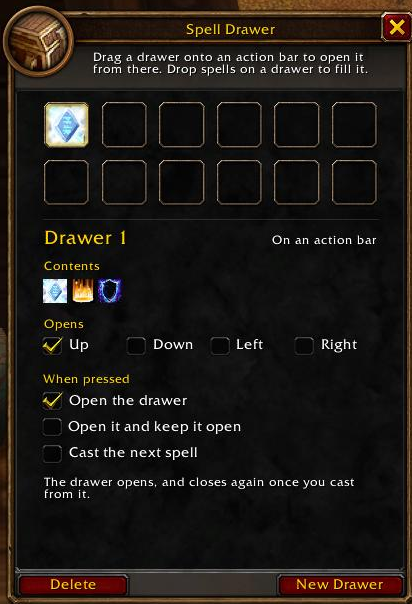

# Spell Drawer

A button that opens a drawer of extra spells, so several spells can share one action bar slot. For WoW Forever.

## Features

- **Drawers:** Fill a drawer with spells, items and macros. It opens up, down, left or right.
- **On your action bar:** Drag a drawer onto any bar slot. It opens from that button, with that slot's keybind, and looks like the bar's own buttons.
- **Cast the next spell:** A drawer can instead cast its spells one per press, which makes short work of buffing. Right-click opens it.
- **In combat:** Opening and casting work in combat. Changing a drawer does not.

## Getting started

1. Type `/sd` to open the options.
2. Drop spells from your spellbook onto a drawer.
3. Drag the drawer from the options onto an action bar, or leave it floating and Alt-drag it into place.

Shift-right-click a button in a drawer to take it out. `/sd help` lists the commands.

## Installation

Download the latest [release](https://github.com/casperstorm/spell-drawer/releases), extract the `SpellDrawer` folder into `World of Warcraft/_forever_/Interface/AddOns`, and restart the game or reload the UI.

## Development

`tests/run.sh` runs the addon's logic against a stand-in for the WoW API (needs Lua 5.1). A release is cut by running the **Release** workflow with a version number.

Spell Drawer is released under the [GPL-3.0 License](LICENSE).
